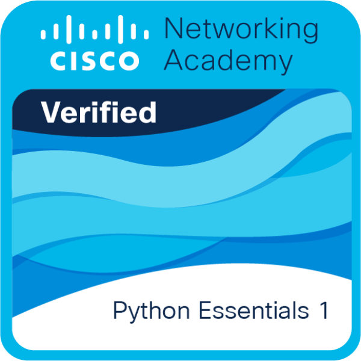

# Python Essentials 1

## Certificate Details
- **Issuer:** Cisco Networking Academy & OpenEDG Python Institute
- **Date Earned:** October 2026
- **Credential URL:** [https://www.netacad.com/courses/python-essentials-1?courseLang=en-US&instance_id=1ce0c3a6-dceb-4285-b850-779879594c22]

## About this Certificate
Python Essentials 1 is an introductory course that covers the basics of programming in Python, including:
- Python syntax and semantics
- Variables, data types, and basic operations
- Control flow (loops and conditional statements)
- Functions and data structures (lists, dictionaries)

## Certificate File
[Click here to view the PDF Certificate](./PythonEssentials1.pdf)